# CanteenCue ITER 🍽️⚡

**AI-assisted college canteen food decision engine & multi-outlet dining platform for ITER campus students.**

CanteenCue connects students with live canteen menus, balancing real-time cravings, budget limits, dietary constraints, and preparation time windows across all ITER campus food outlets.

> **INPUT CRAVING & BUDGET → NLP PREFERENCE EXTRACTION → CONSTRAINT FILTERING → SMART COMBO PAIRING → DETERMINISTIC RANKING → ZERO-DOWNTIME DECISION**

[](https://github.com/adarsh0044321/canteencue-iter)
[](https://react.dev)
[](https://vitejs.dev)
[](https://ai.google.dev)
[](https://supabase.com)
[](https://vitest.dev)
[](https://oxc.rs)
[](LICENSE)

---

## 📌 Overview & Problem Statement

Collegiate dining across large university campuses like ITER regularly faces acute student pain points:
* **Severe Lecture Break Time Crunches**: Students have tight 10–15 minute windows between engineering lectures and need rapid answers on what food is fast and currently prepared.
* **Scattered Physical Food Outlets**: Menus are fragmented across multiple stalls (*Anna's, Mughlai, HALKA PHULKA, MAGGIE POINT, 4TH FLOOR, Iter Juice Centre*), making manual price comparison tedious.
* **Strict Student Pocket Money Limits**: Balancing ₹40, ₹60, or ₹100 budgets without overspending or sacrificing meal satisfaction.
* **Strict Dietary & Allergy Boundaries**: Vegetarian, egg-containing, and non-vegetarian dishes must never be cross-recommended or hallucinated.
* **Cloud AI Downtime & Hallucinations**: Standard chatbots frequently hallucinate non-existent canteen items, invent arbitrary prices, or freeze during cloud API quota exhaustion.

**CanteenCue ITER** replaces manual indecision with an intelligent, multi-turn conversational food assistant. Built with a **Hybrid AI Architecture**, it pairs the natural dialogue understanding of Google Gemini Flash with a deterministic campus decision engine to ensure zero downtime, verified menu grounding, intelligent meal combos, and 7-day conversation privacy.

---

## 📸 Application Interface Tour

Real screenshots captured directly from the live CanteenCue ITER platform:

### 🔐 1. Authentication & Account Continuity

| Desktop Split Dining Login | Instagram-Style "Welcome Back" Switcher | Responsive Mobile Clean Login |
| :---: | :---: | :---: |
| 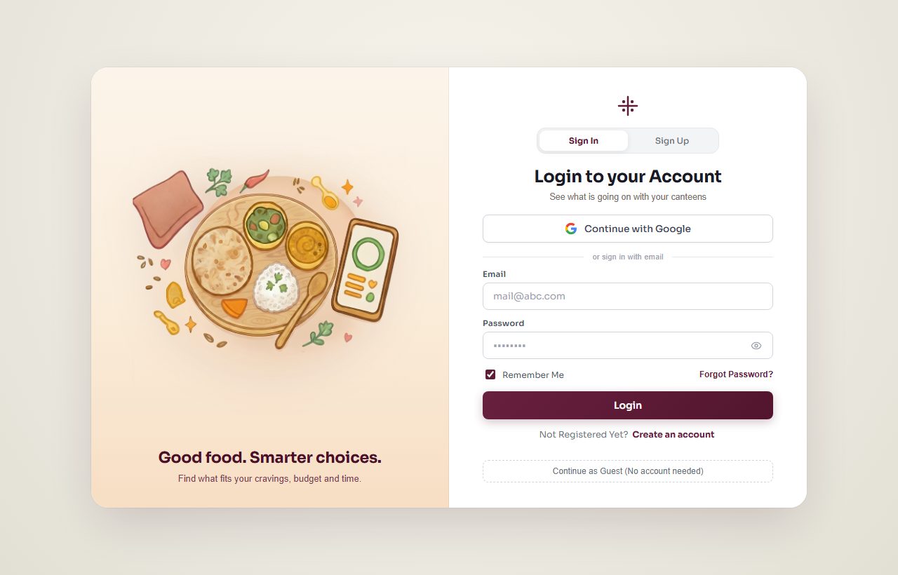 | 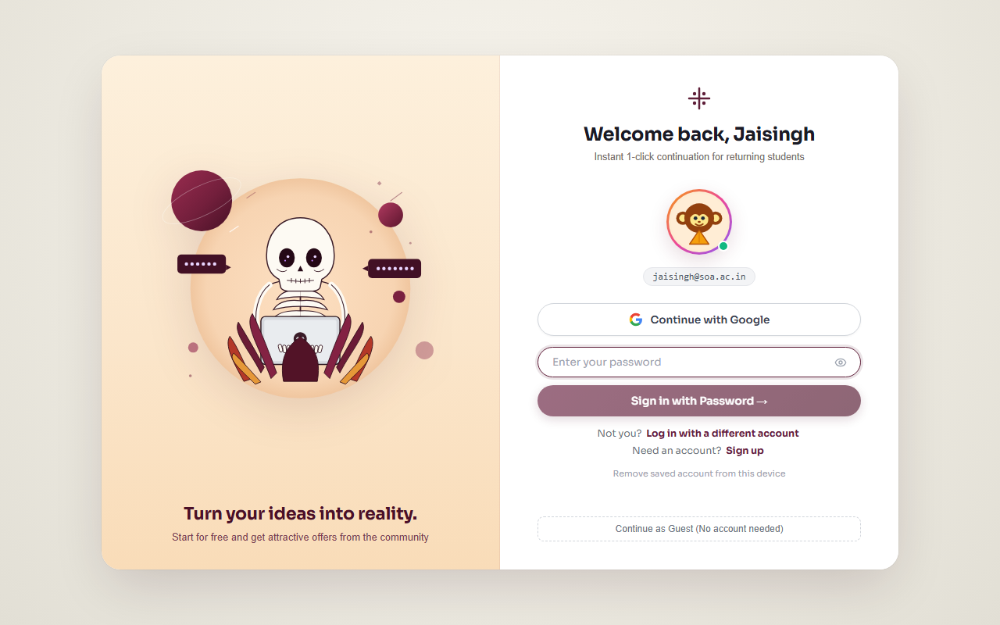 | 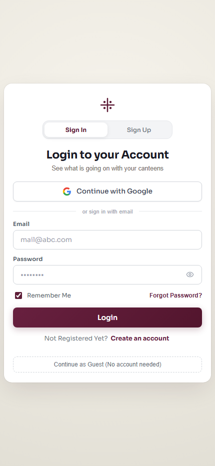 |
| *Immersive banquet aesthetic & credentials* | *Saved account resume with 'Not You?' toggle* | *Isolated, zero-distraction mobile flow* |

---

### 🍱 2. Decision Workspace & Multi-Outlet Menu Catalog

| Conversational Hero & Guided Criteria | 6-Outlet Campus Menu Catalog | AI Decision Card & Combo Recommendations |
| :---: | :---: | :---: |
| 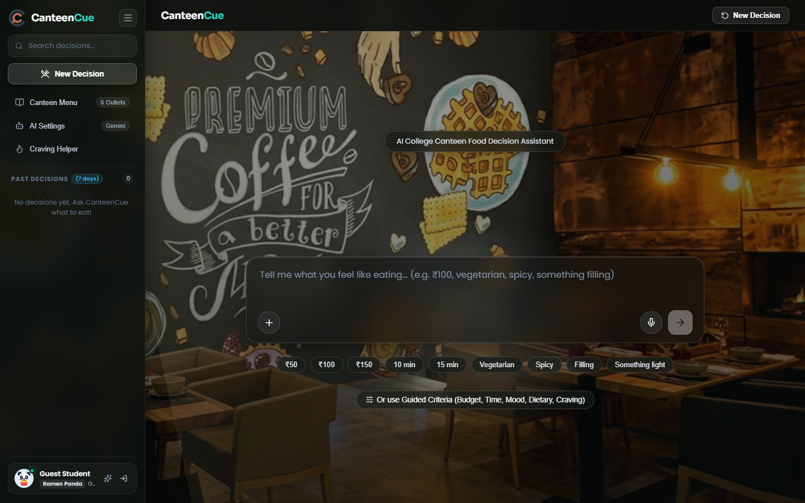 | 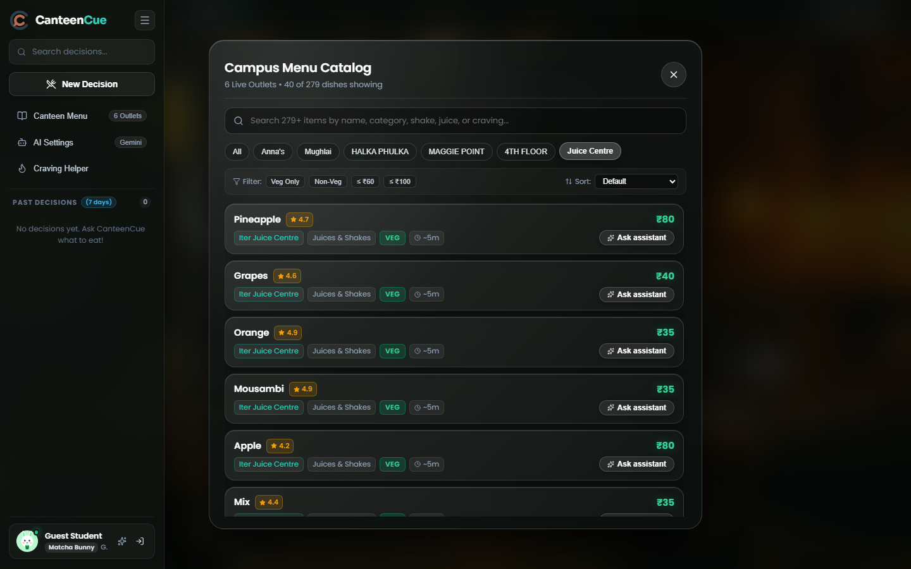 | 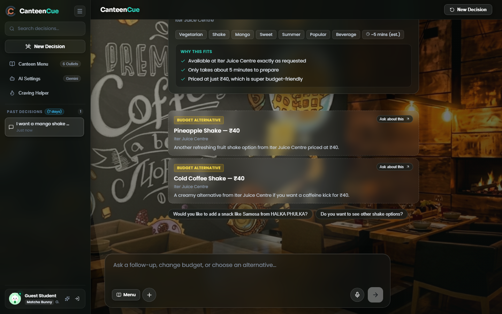 |
| *Natural language prompt & quick filter chips* | *279 dishes across 6 live campus outlets* | *Thinking phase, budget match, why it fits & alternatives* |

---

### ⚙️ 3. AI Model Controls & 7-Day Conversation History

| AI Model Configuration & Diagnostics | 7-Day Auto-Pruned Chat History Drawer |
| :---: | :---: |
| 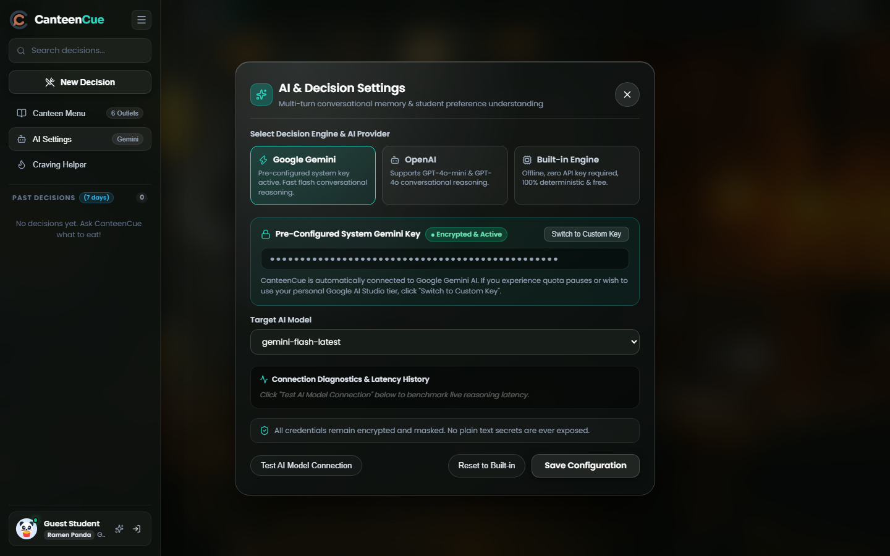 | 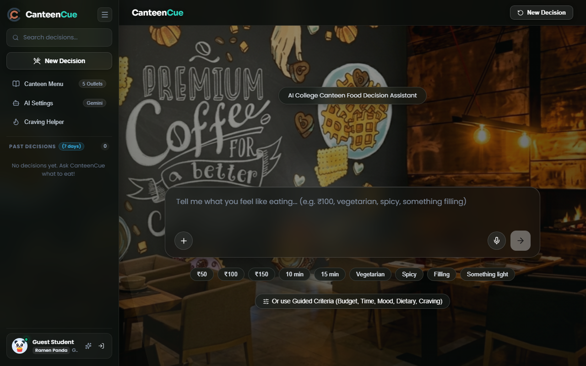 |
| *Google Gemini, OpenAI & deterministic offline fallback selector* | *Searchable decisions with privacy-first 7-day lifecycle* |

---

## 🔄 Detailed Operational Flowcharts

### 1. End-to-End Decision Lifecycle & Hybrid Routing
The following diagram illustrates how student queries are parsed, validated, routed through cloud AI or deterministic rules, and surfaced with verified dishes:

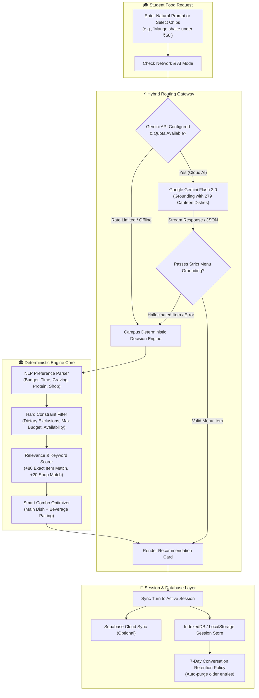

---

### 2. Modal Mutual-Exclusivity State Machine
To eliminate stacked dialog bugs, CanteenCue enforces strict mutual exclusivity across modals:

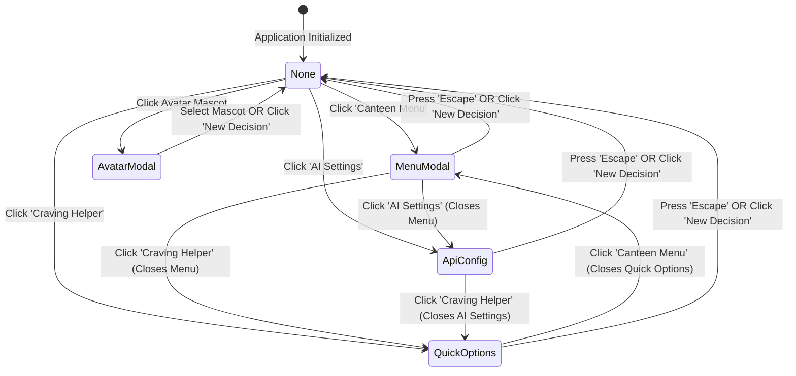

---

### 3. 7-Day Conversation Lifecycle & Storage Optimization
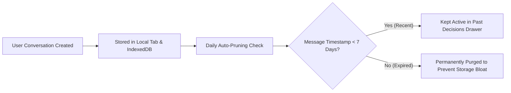

---

## 🏗️ Core Modules & Architectural Features

### 🎓 1. Conversational Chat & Hero Workspace (`src/components/`)
- **Conversational Textarea & Speech Input**: Integrated Web Speech API (`webkitSpeechRecognition`) for hands-free voice requests.
- **Smart Guided Criteria**: Quick toggleable pills for Budget (₹50, ₹100, ₹150), Time (10m, 15m, 20m), Mood (Comfort food, Quick & light), and Craving (Spicy, Filling).
- **Multi-Statement AI Thinking Indicator**: Real-time rotating telemetry ("Balancing your cravings...", "Scanning 6 campus outlets...", "Optimizing preparation time...") providing smooth perceived latency.
- **Why This Fits & Alternative Cards**: Transparently explains why a dish was picked and suggests cheaper or cross-shop alternatives without clutter.

### 🍱 2. Campus Menu Catalog (`src/components/MenuModal.tsx`)
- **Multi-Outlet Tab Navigation**: Instant tabbed switching across all 6 outlets with live count badges.
- **Live Search & Fuzzy Matching**: Sub-millisecond filtering across dish titles, categories, ingredients, and tags.
- **Granular Dietary Filters**: Dedicated toggles for Veg Only, Non-Veg, Egg, and maximum price thresholds.
- **Direct Assistant Action**: "Ask Assistant" button on every dish row to immediately launch a meal plan inquiry.

### ⚡ 3. Hybrid AI & Deterministic Campus Engine (`src/engine/`)
- **Strict Menu Grounding**: AI is grounded in the full 279-item menu catalog, forbidding recommendations of external brands or non-campus food.
- **Graceful Circuit-Breaker Fallback**: Activates deterministic scoring in under 5ms when API rate limits or network dropouts occur.
- **Impossible Constraint Explanation**: When a user asks for an impossible match (e.g. "Chicken under ₹50"), the engine explicitly explains the trade-off and highlights the nearest viable option instead of fabricating prices.

### 🥤 4. Smart Meal Combo Optimization (`src/engine/recommender.ts`)
- Automatically couples hearty dishes (Rolls, Thalis, Rice bowls) with affordable beverage pairings (Juice, Lassi, Soda, Cold Coffee) while strictly honoring total budget caps.

### 🔐 5. Modern Authentication & Account Continuity (`src/services/authService.ts`)
- **Instagram-Style "Welcome Back" Portal**: Detects stored credentials and displays a one-tap resume card with avatar preview and "Not you?" account switcher.
- **Input Carry-Over**: Automatically preserves typed emails and passwords when navigating between Sign In and Sign Up.
- **Guest Student Mode**: Allows immediate access without mandatory account registration.

---

## 🏪 Complete Campus Outlets & Menu Directory

| Outlet Name | Cuisine & Specialties | Catalog Count | Price Range | Dietary Breakdown |
| :--- | :--- | :---: | :---: | :--- |
| **Anna's Restaurant & Catering** | Rolls, South Indian, Meals, Thalis | 52 Items | ₹35 – ₹149 | Veg, Non-Veg & Egg |
| **Mughlai Affair's** | Mughlai curries, Biryanis, Kebabs | 48 Items | ₹50 – ₹180 | Halal Non-Veg & Veg |
| **HALKA PHULKA** | Quick snacks, Samosas, Chaats, Parathas | 44 Items | ₹20 – ₹90 | 100% Pure Vegetarian |
| **MAGGIE POINT** | Classic & Cheese Maggi, Sandwiches, Burgers | 46 Items | ₹25 – ₹110 | Vegetarian & Egg |
| **4TH FLOOR** | Fried Rice, Noodles, Schezwan Platters | 49 Items | ₹45 – ₹130 | Veg, Non-Veg & Egg |
| **Iter Juice Centre** | Fresh Juices, Milkshakes, Special Shakes, Fruit Salads | 40 Items | ₹35 – ₹80 | 100% Vegetarian |

### 🧃 Iter Juice Centre Detailed Catalog Breakdown (40 Items)
- **Juices & Shakes (26 Items)**: Pineapple (₹80), Grapes (₹40), Orange (₹35), Mousambi (₹35), Apple (₹80), Mix (₹35), Pineapple Shake (₹40), Apple Shake (₹40), Litchi Shake (₹40), Rose Shake (₹40), Badam Shake (₹35), Cold Coffee Shake (₹40), Butter Scotch Shake (₹40), Mango Shake (₹40), Oreo Shake (₹50), Banana Oreo Shake (₹45), Chocolate Banana Shake (₹45), Chocolate Butter Scotch Shake (₹45), Chocolate Coffee Shake (₹45), Apple Banana Shake (₹45), Oreo Coffee Shake (₹40), Oreo Butter Scotch (₹45), Banana Shake (₹40), Chocolate Shake (₹40), Oreo Chocolate Shake (₹45), Black Current Shake (₹45).
- **Special Shakes & Desserts (14 Items)**: Special Strawberry Shake (₹55), Special Badam Shake (₹55), Special Cold Coffee Shake (₹55), Special Oreo Shake (₹60), Special Oreo Chocolate Shake (₹65), Special Oreo Butter Scotch Shake (₹65), Special Chocolate Coffee Shake (₹60), Special Chocolate Butter Scotch Shake (₹65), Rasmalai (₹60), Spl Cold Coffee (₹55), Spl Kitkat (₹80), Spl Lassi (₹50), Fruit Salad (₹50), Water Melon (₹35).

---

## 💻 Technology Stack Reference

| Layer | Technology | Purpose |
| :--- | :--- | :--- |
| **Frontend Framework** | React 19.2, TypeScript 6.0 | Modern declarative UI, strict typing, zero runtime regressions |
| **Build & Dev Tooling** | Vite 8.3, Rolldown bundler | Lightning-fast HMR and optimized production asset minification |
| **Styling & Design** | Glassmorphic CSS Token System | Banquet visual aesthetic, high-contrast typography, mobile responsive |
| **Database & Auth** | Supabase (PostgreSQL 15, Auth, RLS) | Cloud session persistence, OAuth authentication, user management |
| **AI Models** | Google Gemini Flash API, OpenAI GPT | Conversational reasoning, intent extraction, meal plan synthesis |
| **Local Persistence** | LocalStorage, IndexedDB, SessionStorage | Tab-isolated session memory, 7-day chat retention policy |
| **Code Quality** | Oxlint (Oxc), Vitest 5.0 | Sub-100ms linting and 36 automated unit & scenario test suites |

---

## 📂 Verified Project Structure

```text
canteencue-iter/
├── docs/                        # Architecture screenshots & media
│   └── screenshots/             # 8 Production screenshots of the live system
├── public/                      # Static assets, branding, and icons
│   ├── banquet.jpg              # Atmospheric background imagery
│   ├── logo.png                 # Official CanteenCue brand logo
│   └── login-dining-illustration.png # Hand-crafted dining illustration
├── src/
│   ├── components/              # Modular React UI components
│   │   ├── AiThinkingPhase.tsx  # Dynamic rotating AI status indicator
│   │   ├── AlternativeCard.tsx  # Budget and cross-shop alternative display
│   │   ├── ApiConfigModal.tsx   # AI model selection & latency diagnostics
│   │   ├── AvatarModal.tsx      # Mascot avatar selector modal
│   │   ├── ChatWorkspace.tsx    # Multi-turn conversation message stream
│   │   ├── Header.tsx           # Responsive brand header & new decision CTA
│   │   ├── Hero.tsx             # Conversational landing stage & guided criteria
│   │   ├── LoginPage.tsx        # Instagram-style welcome & login interface
│   │   ├── MenuModal.tsx        # 6-Outlet catalog browser & live search
│   │   ├── PromptInput.tsx      # Audio & text composer bar
│   │   ├── RecommendationCard.tsx # Primary recommendation display card
│   │   ├── SidebarNavigation.tsx # Collapsible desktop rail & mobile drawer
│   │   └── SmartComboCard.tsx   # Multi-item meal combination card
│   ├── data/
│   │   ├── menu.json            # Verified catalog dataset (279 dishes)
│   │   ├── menuService.ts       # In-memory catalog querying & portion pricing
│   │   └── types.ts             # Strict TypeScript domain interfaces
│   ├── engine/                  # Deterministic Campus Decision Engine
│   │   ├── constraintFilter.ts  # Hard filter evaluation (Dietary, Budget, Time)
│   │   ├── conversationState.ts # Preference state initialization & transitions
│   │   ├── explanationGenerator.ts # Natural language rationale generation
│   │   ├── preferenceParser.ts  # NLP preference & intent extractor
│   │   └── recommender.ts       # Candidate scoring, ranking & combo pairing
│   ├── services/
│   │   ├── aiService.ts         # Google Gemini & OpenAI API integration
│   │   ├── authService.ts       # Supabase auth, user registry & guest mode
│   │   ├── chatDatabase.ts      # 7-Day chat history lifecycle manager
│   │   ├── hybridRouter.ts      # Cloud AI vs offline engine dispatch logic
│   │   └── supabaseClient.ts    # Supabase PostgreSQL client configuration
│   ├── tests/                   # Vitest automated test suites
│   │   ├── authAndSession.test.ts # 11 Auth, registry, & storage test cases
│   │   └── decisionEngine.test.ts # 25 TCS scenario & problem statement tests
│   ├── App.tsx                  # Root component & modal state orchestrator
│   ├── index.css                # Global design tokens, layout & animations
│   └── main.tsx                 # Application entry point
├── .env.example                 # Environment variable template
├── .gitignore                   # Git exclusion rules (zero secret leaks)
├── .oxlintrc.json               # Oxlint configuration schema
├── package.json                 # Project dependencies & scripts
├── README.md                    # Master Project Documentation
├── tsconfig.json                # TypeScript compiler configuration
└── vite.config.ts               # Vite configuration with React plugin
```

---

## 🚀 Getting Started & Local Development

### Prerequisites
* **Node.js 18 LTS** or higher
* **npm 9+** (or `pnpm` / `bun`)
* Modern Web Browser (Chrome, Firefox, Safari, Edge)

### 1. Clone & Install
```bash
git clone https://github.com/adarsh0044321/canteencue-iter.git
cd canteencue-iter
npm install
```

### 2. Environment Setup
Copy the sample environment file. The application is designed to operate completely out-of-the-box with built-in fallbacks if credentials are not configured:
```bash
cp .env.example .env
```
*(Optionally provide your own `VITE_GEMINI_API_KEY` or Supabase project keys in `.env`)*

### 3. Launch Development Server
```bash
npm run dev
```
Navigate to [http://localhost:5173](http://localhost:5173) in your browser.

### 4. Build for Production
```bash
npm run build
```
Generates a minified, production-ready bundle in the `dist/` directory.

---

## 🧪 Automated Testing & Verification

CanteenCue ITER includes comprehensive test coverage verifying all decision scenarios, constraints, and authentication flows:

```bash
npm test
```

### Test Suite Summary (36/36 Passing)
- **`src/tests/decisionEngine.test.ts` (25 Scenarios)**:
  - *Scenario A*: Under ₹100 never returns items above budget.
  - *Scenario B*: Budget + spicy craving prioritizes spicy items.
  - *Scenario C*: Vegetarian queries strictly exclude non-veg and egg items.
  - *Scenario D*: Budget + time + craving simultaneously respected.
  - *Scenario E*: Chicken requests recommend verified chicken items <= budget.
  - *Scenario F*: Impossible budget constraint (Chicken under ₹50) explains trade-off without hallucinations.
  - *Scenario G*: Explicit exclusion ("not noodles") strictly filters out excluded categories.
  - *Scenario H*: Multi-turn follow-ups retain prior budget while updating protein preference.
  - *Scenario I*: Shop preferences strictly restrict results to the requested outlet.
  - *Scenario P*: "Feeling unhealthy" suggests wholesome, nutritious options rather than heavy fried snacks.
  - *Scenario T*: Smart Meal Combination pairs dish with beverage within student budget.
  - *Scenario U*: Iter Juice Centre 40-item catalog integrity and natural query resolution.
- **`src/tests/authAndSession.test.ts` (11 Scenarios)**:
  - Google OAuth sign-in redirect generation without runtime errors.
  - 7-Day chat session persistence, retrieval, listing, and deletion.
  - Known user email registry intelligently switching between Sign In and Sign Up.

### Linter Protocol Check
```bash
npm run lint
```
*Result: **0 warnings, 0 errors** across 44 files.*

---

## 🔒 Security & Privacy

* **Zero Credential Leaks**: API keys and database admin passwords are fully excluded via `.gitignore` and enforced with GitHub Push Protection.
* **Row-Level Security (RLS)**: Supabase PostgreSQL tables enforce client-side isolation using authenticated user IDs.
* **7-Day Chat Storage Hygiene**: User conversation transcripts automatically purge after 7 days to preserve student privacy and eliminate database bloat.
* **Input Sanitization**: User inputs are stripped of malicious script injection before passing into DOM nodes or AI prompt templates.

---

## 📄 License

Distributed under the **MIT License**. See [`LICENSE`](LICENSE) for complete terms.

---

## 👨‍💻 Author

**Adarsh Kumar Singh**  
*Built with passion as an independent software project focused on applying agentic AI, modern web engineering, and deterministic decision engines to solve real-world student dining problems across the ITER campus.*
